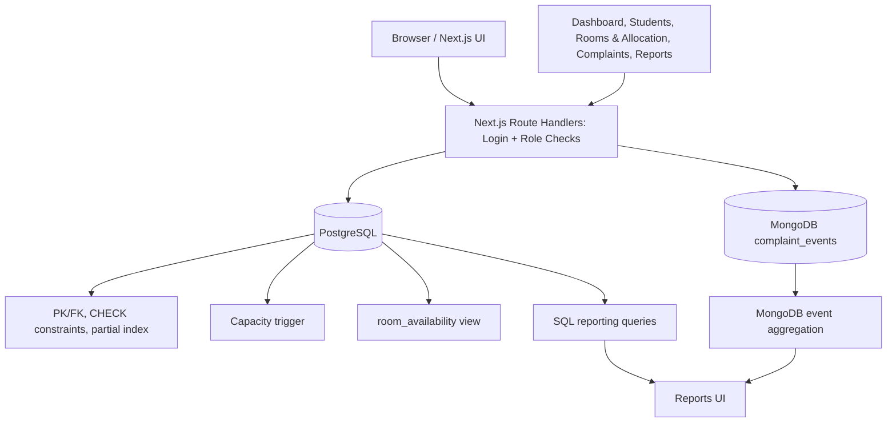

# System architecture

## Request flow examples
1. **Room allocation:** Browser → authenticated API → PostgreSQL transaction → lock selected room → validate status and student's active allocation → INSERT → trigger validates capacity → COMMIT; on error, ROLLBACK.
2. **Complaint status change:** Browser → backend role/assignment check → PostgreSQL transaction updates current complaint status → MongoDB receives an event document → UI shows the saved status and whether activity logging succeeded.
3. **Reports:** the API runs PostgreSQL joins/aggregations/subqueries and a MongoDB `$group` aggregation; the UI displays both sources separately.

## Configuration and security
- `DATABASE_URL`, `MONGODB_URI`, `MONGODB_DB`, and `SESSION_SECRET` are read from environment variables.
- Login sets a signed, HttpOnly, SameSite=Lax cookie. Backend routes enforce roles; hiding a UI control is not treated as authorization.
- SQL uses parameterized queries for values.
- Passwords in the demo seed are stored as scrypt hashes.
